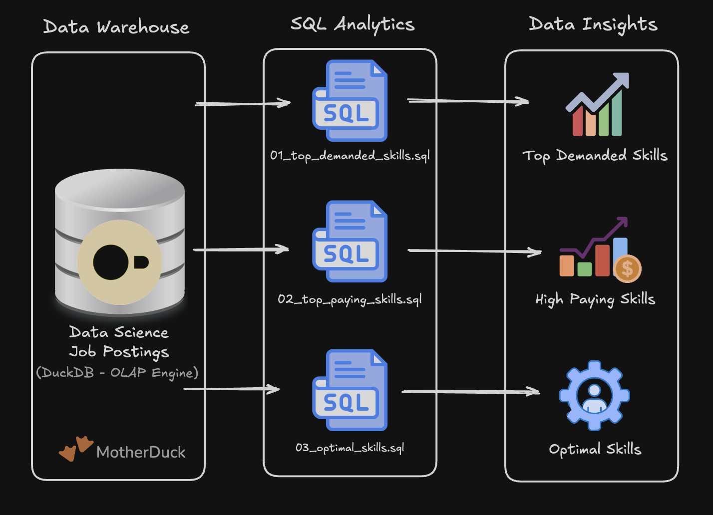

# Data Engineering Projects

Hands-on projects to reinforce core data engineering concepts from the SQL for Data Engineering course.

# Projects

### [1. EDA](/1_EDA/) - Exploratory Data Analysis

SQL-driven analysis of data engineer job market trends using advanced querying techniques.

**Skills:** Complex joins, aggregations, analytical functions, data quality validation

### [3_Flat_to_WH_Build/](/2_DW_Mart_Build/) - Data Pipline - Data Warehouse & Mart

End-to-end ETL pipeline transforming raw CSV files into a star schema data warehouse and analytical data marts.

**Skills:** Dimensional modeling, ETL pipeline development, data mart architecture, production practices

### 📊 End-to-End Data Warehouse Pipeline

An end-to-end Data Engineering project that transforms raw job posting CSV Google Cloud Storage datasets into a DuckDB-based Data Warehouse using a dimensional data model. It builds analytical data marts, including Flat Mart, Skills Mart, and Priority Mart, to support business intelligence, reporting, and data analysis through tools such as Excel, Power BI, Tableau, and Python.

SQL-driven transformation of flat job posting data into a normalized star schema using DuckDB.

**Skills:** Data transformation, star schema design, ETL pipeline development, production practices.
